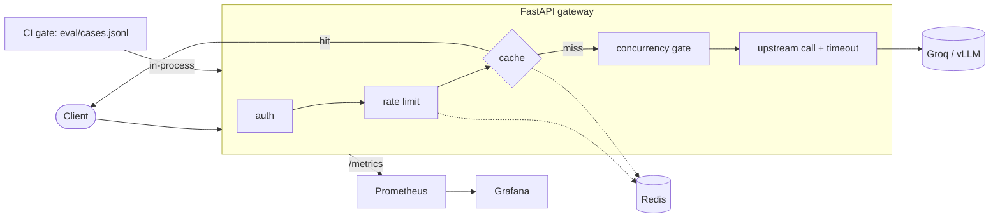

# LLM Serving: Gateway, Caching, Metrics and a CI Quality Gate

An OpenAI-compatible gateway in front of any OpenAI-compatible model (the Groq API, or a self-hosted vLLM). It adds what a production LLM service needs: auth, per-key rate limits, exact and semantic caching, load shedding, timeouts, Prometheus metrics with a Grafana dashboard, and a prompt regression gate that CI can use to block a degraded prompt.


> **Status: tested in parts, stack and load test not yet run.** The gateway logic, the cache, the rate limiter and the gate scoring have 13 passing unit tests that need no network. The Docker stack, the Locust load test and the gate against a real model have not been run, so this README reports **no latency, throughput or cost numbers**. See [Status and findings](#status-and-findings).

## Architecture



A picture version is in `docs/architecture.svg`.

## What is here

| Concern | Implementation |
|---|---|
| OpenAI-compatible API, streaming | `POST /v1/chat/completions` (`stream: true` relays SSE and still records token usage) |
| Auth and per-key rate limit | `API_KEYS=name:key:rpm`, fixed one-minute window in Redis, `429` with `Retry-After` |
| Cache | Exact (hash of the request), then semantic (cosine over embeddings, opt-in with `SEMANTIC_CACHE=1`). Only `temperature=0` and non-streaming. Semantic hits require identical settings and system prompt |
| Overload | Bounded concurrency; waiting longer than `QUEUE_TIMEOUT_S` returns `503` instead of queueing forever |
| Timeouts and errors | Upstream timeout gives `504`, other upstream failures give `502`, each with its own metric |
| Health | `/health` (liveness) and `/ready` (store reachable, upstream key set) |
| Metrics | `llm_requests_total{consumer,status,cache}`, `llm_request_seconds`, `llm_tokens_total`, `llm_cost_usd_total` |
| Dashboard | `monitoring/grafana/dashboards/llm.json`, auto-provisioned: requests per second by status, p50/p95/p99 latency, cache hit rate, error rate, token rate, estimated spend per consumer |
| Regression gate | `eval/gate.py` scores 12 rule-checked cases (facts, format, refusal, prompt injection) through the service in-process and exits 1 below `eval/baseline.json` |
| Load test | `eval/locustfile.py` |

## Quickstart

```bash
cp .env.example .env            # set GROQ_API_KEY and change the API_KEYS
make up                         # app :8000, Prometheus :9090, Grafana :3000
curl -s localhost:8000/v1/chat/completions \
  -H 'Authorization: Bearer sk-local-a' -H 'content-type: application/json' \
  -d '{"messages":[{"role":"user","content":"What is the capital of France?"}]}'
make setup && make test         # unit tests, no network needed
make gate                       # real-LLM regression gate (needs the key)
make gate PROMPT=prompts/system_degraded.txt   # must exit non-zero
make load                       # Locust against the running stack
```

Self-hosted model (needs an NVIDIA GPU): `docker compose --profile vllm up`, then set `UPSTREAM_URL=http://vllm:8000/v1` and `MODEL=Qwen/Qwen2.5-1.5B-Instruct`.

## The quality gate

`prompts/system_v1.txt` is the system prompt under test, and `prompts/system_degraded.txt` is a deliberately bad one. The gate runs 12 cases from `eval/cases.jsonl`, each checked by deterministic rules (required words, forbidden words, maximum length). It fails when the score is below `min_score` (0.85) or drops more than `max_drop` (0.05) from the recorded baseline. The CI workflow runs the current prompt (must pass) and the degraded prompt (must be blocked) when a `GROQ_API_KEY` secret is set.

## Results

**Not measured yet.** After a real run, record the load test (`make load`) and the gate score, and set `score` in `eval/baseline.json` to the first passing run. The model prices in `src/serving/config.py` are unverified placeholders: check the provider's pricing page before quoting a cost.

## Status and findings

Checked on 2026-10-30:

- **Tests:** 13 unit tests pass (app behaviour with a stub upstream, cache and rate limit, gate scoring and verdict logic). `ruff check` passes.
- **Configuration:** the Grafana dashboard (6 panels) and `eval/baseline.json` parse as valid JSON. The Docker Compose and YAML files were not validated.
- **Fixed while preparing this repository:** four lint findings (an aliased `TimeoutError`, a `datetime.UTC` alias, and a blind `except` in the readiness probe, now marked as intentional).
- **Not run:** the Docker stack, Prometheus and Grafana, the Locust load test, the gate against a real model, and the vLLM profile. Whether the gate really blocks the degraded prompt is untested against a live model. The offline test only checks the pass and fail logic with a stub.
- **Baseline:** `eval/baseline.json` has `score: null`, so only the minimum score is enforced until a first real passing run is recorded.

## Trade-offs and known limits

- Fixed-window rate limiting allows a 2x burst at window edges. A sliding window or token bucket fixes that.
- The semantic cache scans linearly and never expires entries. Fine for thousands of entries, not millions.
- The synchronous Redis client briefly blocks the event loop. Use `redis.asyncio` under real load.
- Rule-based gate scoring is deterministic and cheap but coarse. It cannot judge nuance, so pair it with an LLM judge for open-ended tasks.
- Streaming bypasses the cache, and cached responses replay as non-streaming JSON.
- Dependencies use lower bounds only. Generate a lock file (`uv lock` or `pip-compile`) when you first install.
- Not built: tracing, multi-replica rate-limit fairness tests, auth beyond static API keys.

## Credits

Ideas from vLLM (OpenAI-compatible serving, an optional dependency) and the BerriAI LiteLLM proxy (budgets, caching, fallbacks). No code was copied, and their licences were not checked.

## License

[MIT](LICENSE)
